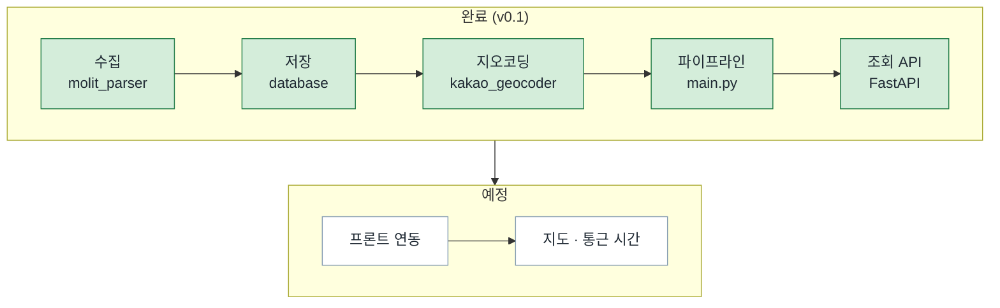

# RHC (Real Housing Cost) - 실질 주거비 계산기

월세와 관리비만 비교하는 방식에서 벗어나, **직장까지의 출퇴근 시간을 내 시급으로 환산해 실제 주거비에 합산**하는 비교 계산기입니다.

현재는 계산기에 필요한 **실거래 데이터 파이프라인(v0.1)** 이 완성된 단계입니다.

## 계산 모델

```text
실질 주거비 = 월세 + 관리비 + 공과금 + 보증금 대출 이자 + 통근 기회비용
통근 기회비용 = 통근 시간 가치 + 교통비
통근 시간 가치 = 적용 시급 × 왕복 통근 시간 × 월 근무일
```

관리비, 공과금, 대출 조건, 교통비는 공개 API로 구하기 어려워 사용자가 직접 입력합니다.

## 진행 현황



- [x] 국토부 아파트 전월세 실거래 수집 (페이지네이션, 지번 포함)
- [x] SQLite 저장, 재실행 시 중복 방지 (UNIQUE + INSERT OR IGNORE)
- [x] 카카오 지오코딩 (동+지번 주소 검색, 건물 단위 1회 조회)
- [x] 수집 → 저장 → 지오코딩 파이프라인 (`main.py`)
- [x] 조회 API (FastAPI): 건물 검색, 건물별 거래 조회
- [ ] 프론트 연동: 건물 선택 시 보증금·월세 자동 입력
- [ ] 지도 표시, 통근 시간 계산 (직선 거리 추정 → 경로 API)
- [ ] 안정성 보강, 데이터 확장(서울 전체), DB 정규화

## 데이터 파이프라인

```text
국토부 API → molit_parser.py → database.py (SQLite) → kakao_geocoder.py → rhc_database.db
  (수집·파싱)      (저장, 중복 방지)         (좌표 변환)
```

| 파일 | 역할 |
|---|---|
| `backend/molit_parser.py` | 국토부 API 호출, XML 파싱, 페이지 반복 수집 |
| `backend/database.py` | 테이블 생성, 중복을 건너뛰는 저장 |
| `backend/kakao_geocoder.py` | 동+지번 주소로 좌표 조회, DB 갱신 |
| `backend/main.py` | 위 세 단계를 순서대로 실행 |

## 실행 방법

### 1. 설치

```bash
git clone https://github.com/HY25N/RHC.git
cd RHC/backend
pip install -r requirements.txt
```

### 2. API 키 설정

`backend` 폴더에 `.env` 파일을 만들고 키를 넣습니다. 이 파일은 git에 올라가지 않습니다.

```text
MOLIT_API_KEY=공공데이터포털에서 발급받은 키
KAKAO_REST_API_KEY=카카오 개발자 사이트에서 발급받은 REST API 키
```

### 3. 실행

```bash
python main.py
```

- 첫 실행: 거래 데이터를 적재하고 좌표를 채웁니다.
- 두 번째 실행: `신규 0건 적재, N건 중복 스킵`이 나오면 중복 방지가 정상 동작하는 것입니다.
- DB 파일(`rhc_database.db`)은 실행한 폴더에 만들어집니다.

수집 대상은 현재 코드에 고정되어 있습니다. 바꾸려면 `backend/molit_parser.py`의 `lawd_cd`(시군구 코드, 기본 종로구 `11110`)와 `deal_ymd`(계약 연월)를 수정하세요. 지오코더의 주소 접두어(`서울특별시 종로구`)도 함께 바꿔야 합니다.

### 4. 조회 API 서버 실행

```bash
python -m uvicorn api:app --reload
```

- `http://127.0.0.1:8000/docs`: API 문서 (직접 호출해 볼 수 있음)
- `/buildings?q=건물명`: 건물명 검색 (예: `/buildings?q=경희궁`)
- `/deals?region_code=…&dong=…&jibun=…&building_name=…`: 건물별 거래 조회

서버를 켜기 전에 `python main.py`를 한 번 실행해서 DB(`rhc_database.db`)가 만들어져 있어야 합니다.

## 검증 결과

| 항목 | 개선 전 | 개선 후 |
|---|---|---|
| 수집 건수 (종로구 2023-12) | 10건 | 223건 (페이지네이션) |
| 지오코딩 (2023-12) | 20건 전부 실패 | 201건 전부 성공 (건물명 → 동+지번 검색) |
| 재실행 | 중복 적재 | 신규 0건 |

최신 월 검증 (종로구 2026-10): 135건 수집, 신규 130건 적재(5건은 동일 조건 거래로 중복 처리), 지오코딩 대상 49개 건물 모두 성공.

지오코딩 성공은 카카오가 결과를 돌려줬다는 의미이며, 좌표가 실제 위치와 일치하는지는 전수 검증하지 않았습니다.

## 데이터베이스

테이블 `real_estate_deals` (SQLite)

| 컬럼 | 설명 |
|---|---|
| `region_code`, `dong`, `jibun` | 시군구 코드, 동, 지번 |
| `building_name` | 건물명 |
| `deal_type` | 전세 또는 월세 |
| `deposit`, `monthly_rent` | 보증금, 월세 (만원) |
| `exclusive_area` | 전용면적 (㎡) |
| `deal_year`, `deal_month`, `deal_day` | 계약일 |
| `floor` | 층 |
| `latitude`, `longitude` | 좌표 (지오코딩 후 채워짐) |

지역코드, 동, 건물명, 거래 유형, 금액, 면적, 계약일, 층의 조합이 같으면 같은 거래로 보고 한 번만 저장합니다.

## 알려진 한계

- 지역(종로구)과 계약월이 코드에 고정되어 있습니다.
- 국토부 API의 에러 응답 감지와 timeout은 아직 적용하지 않았습니다. (카카오 요청에는 적용됨)
- 국토부 데이터에 호수 정보가 없어, 같은 단지·층·면적·금액·날짜의 거래는 하나로 합쳐집니다.
- 아파트 전월세만 수집합니다.
- `schema.sql`은 실제 테이블 구조와 일치하지 않아 갱신 예정입니다.

## 기술 스택

- Python (requests, python-dotenv)
- SQLite
- 국토교통부 아파트 전월세 실거래가 API (공공데이터포털)
- 카카오 Local API (지오코딩)

## 개발 방식

`main` ← `develop` ← `feature/*` 브랜치 구조로, 기능 단위 PR로 병합합니다. 한 번에 하나씩 수정하고, 실행해서 확인한 뒤 커밋합니다.
